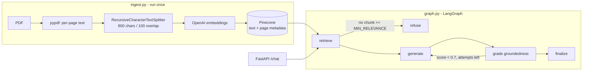

# Agentic AI eBook RAG Chatbot (LangGraph + Pinecone)

A Retrieval-Augmented Generation chatbot that answers **only** from the *Agentic AI* eBook.
Built in plain Python: LangGraph for orchestration, OpenAI for embeddings/LLM, Pinecone as the vector DB, FastAPI for the API.

## Architecture



| Node | What it does |
|---|---|
| `retrieve` | Embeds the query, fetches top-k from Pinecone, drops chunks under a cosine-similarity floor. |
| `refuse` | If nothing relevant was retrieved (e.g. "capital of France"), returns a refusal without calling the LLM. |
| `generate` | LLM (temperature 0) answers **only** from numbered context; must emit a fixed refusal string if the answer is absent. |
| `grade` | A second LLM call acts as a fact-checker: returns the fraction of answer claims supported by the context, plus the unsupported claims. |
| conditional loop | If grounding < 0.7, `generate` re-runs with the unsupported claims as feedback (max 2 attempts) - this is the cycle in the graph. |
| `finalize` | If still < 0.5 grounded, replaces the answer with a safe fallback. Otherwise computes the confidence score. |

**Confidence score** = `0.7 × grounding score + 0.3 × mean retrieval similarity` (rounded to 2 dp). Refusals return `0.0`.
It is a heuristic, not a calibrated probability.

**Hallucination defences (layered):** similarity floor → context-only prompt with explicit refusal string → LLM groundedness grading → regenerate loop → final fallback.

## Setup

```bash
python -m venv .venv && source .venv/bin/activate
pip install -r requirements.txt
cp .env.example .env        # add OPENAI_API_KEY and PINECONE_API_KEY
```

### 1. Ingest
Put `Ebook-Agentic-AI.pdf` in `data/` **or** provide its URL:
```bash
python ingest.py --url <EBOOK_PDF_URL>     # or: python ingest.py  (uses data/ or $PDF_URL)
```
This creates the Pinecone serverless index if needed (cosine, 1536-d) and upserts chunks with `text`, `page`, `source` metadata. IDs are content-hashed, so re-running is safe.

### 2. Run the API
```bash
uvicorn api:app --reload
curl -X POST localhost:8000/chat -H "Content-Type: application/json" \
     -d '{"query": "What is Agentic AI?"}'
```
Response:
```json
{
  "query": "What is Agentic AI?",
  "final_answer": "...",
  "retrieved_context_chunks": ["...", "..."],
  "confidence_score": 0.9
}
```
Interactive docs: http://localhost:8000/docs

### 3. Validate with the six sample queries
```bash
python scripts/run_sample_queries.py     # writes sample_outputs.json
```
The last query (capital of France) should be refused with confidence `0.0`.

## Configuration
All knobs live in `.env` (see `.env.example`): chunk size/overlap, `TOP_K`, `MIN_RELEVANCE`, `GROUNDING_THRESHOLD`, models, etc.
`MIN_RELEVANCE` (default 0.25) depends on the embedding model - check the scores of in/out-of-scope queries and tune if needed.

## Project layout
```
config.py                    env-driven settings
ingest.py                    PDF -> chunks -> embeddings -> Pinecone
graph.py                     LangGraph workflow + ask()
api.py                       FastAPI app (/chat, /health)
scripts/run_sample_queries.py
```

## Known limitations
- The LLM-as-judge grounding score adds one extra LLM call per attempt (latency/cost trade-off for safety).
- pypdf extraction quality depends on the PDF; multi-column or image-heavy pages may yield noisy text.
- Single-turn only; no conversation memory.
